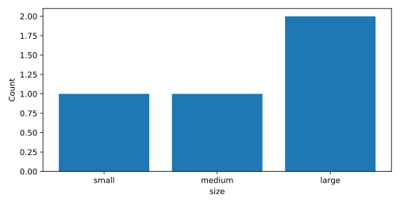
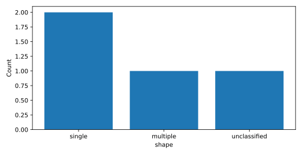
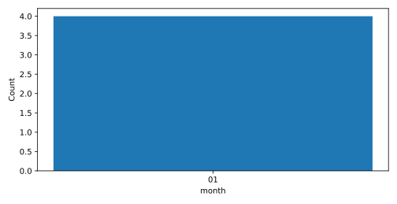

# 预分析

<!-- section:overview -->
## 资料与时段概况

<!-- paragraph:overview-count kind:fact -->
本次资料包含 4 场已提取洪水；以下按明确的统计口径概括规模和峰型。

表 1 · 资料概况 / Data coverage

| 项目 | 数值 | 单位 | 资料集合 |
| --- | --- | --- | --- |
| standard_flow_unit | m3/s | unspecified | flow |
| timestep_seconds | 3600 | unspecified | flow |
| timezone | Asia/Shanghai | unspecified | flow |
| row_count | 24 | count | 洪水场次数 |
| start | 2019-12-31T23:00:00 | unspecified | 洪水场次数 |
| end | 2020-01-01T04:00:00 | unspecified | 洪水场次数 |
| row_count | 4 | count | 洪水场次数 |

表 2 · 洪水总数 / Event count

| 项目 | 数值 | 单位 |
| --- | --- | --- |
| 洪水场次数 | 4 | count |

<!-- section:sizes -->
## 洪水规模分布

表 3 · peak_flow_m3_s

| 单位 | 分级依据 | 规模 | 有效数量 | 比例（%） | 比例分母 | 缺失数量 | 下阈值 | 上阈值 |
| --- | --- | --- | --- | --- | --- | --- | --- | --- |
| m3/s | 洪峰流量 | 小洪水 | 1 | 25.0 | 4 | 0 | 10 | 20 |
| m3/s | 洪峰流量 | 中洪水 | 1 | 25.0 | 4 | 0 | 10 | 20 |
| m3/s | 洪峰流量 | 大洪水 | 2 | 50.0 | 4 | 0 | 10 | 20 |

表 4 · total_volume_m3

| 单位 | 分级依据 | 规模 | 有效数量 | 比例（%） | 比例分母 | 缺失数量 | 下阈值 | 上阈值 |
| --- | --- | --- | --- | --- | --- | --- | --- | --- |
| m3 | 总洪量 | 小洪水 | 1 | 25.0 | 4 | 0 | 100 | 200 |
| m3 | 总洪量 | 中洪水 | 1 | 25.0 | 4 | 0 | 100 | 200 |
| m3 | 总洪量 | 大洪水 | 2 | 50.0 | 4 | 0 | 100 | 200 |

图 1 · peak_flow_m3_s

图 2 · total_volume_m3

<!-- section:shapes -->
## 洪峰形态

表 5 · 显著峰型 / Significant peaks

| 有效数量 | 比例（%） | 比例分母 | 峰型 |
| --- | --- | --- | --- |
| 2 | 66.7 | 3 | 单峰 |
| 1 | 33.3 | 3 | 多峰 |
| 1 | 不可用 / unavailable | 3 | 无法分类 |

表 6 · 显著峰口径 / Peak criteria

| 项目 | 数值 | 单位 |
| --- | --- | --- |
| 最小峰间隔 | 1 | hours |
| 洪峰突出度 | 0.500 | m3/s |

图 3 · 显著峰型 / Significant peaks

<!-- section:events -->
## 事件总体特征

表 7 · 事件分布 / Event distributions

| 单位 | 有效数量 | 指标 | 均值 | 中位数 | P10 | P90 | 最小值 | 最大值 |
| --- | --- | --- | --- | --- | --- | --- | --- | --- |
| m3/s | 4 | 洪峰流量 | 17.250 | 15.000 | 9.300 | 27.000 | 9.000 | 30.000 |
| m3 | 4 | 总洪量 | 174.750 | 150.000 | 99.300 | 270.000 | 99.000 | 300.000 |
| hours | 4 | 历时 | 4.000 | 4.000 | 4.000 | 4.000 | 4.000 | 4.000 |

表 8 · 月份分布 / Months

| 有效数量 | 月份 |
| --- | --- |
| 4 | 01 |

图 4 · 月份分布 / Months

<!-- section:limitations -->
## 限制与建议

<!-- paragraph:limitation-0 kind:fact -->
分级仅表示调用方阈值下的相对规模，不是工程等级。月份分布仅描述现有时段，不代表长期气候规律。

部分资料未提供，相关分析范围受限；详见资料缺口附件。

