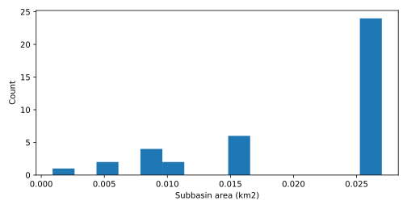
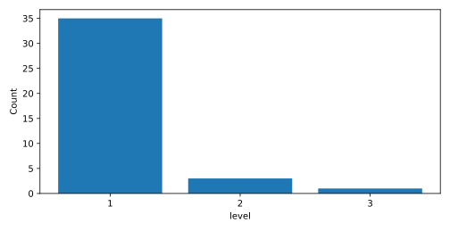
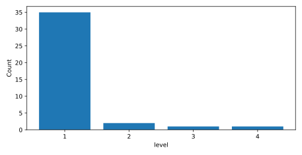
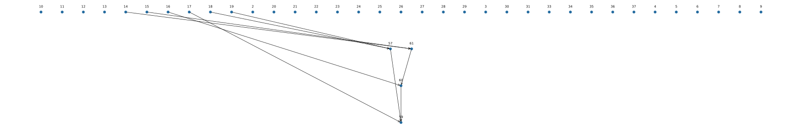

# Spatial processing

<!-- section:overview -->
## 流域概况

<!-- paragraph:overview-spatial kind:fact -->
本次空间成果划分为 39 个子流域、39 条河段和 30 个出口，以下汇总其空间组成与汇流连接。

表 1 · 空间基础 / Spatial foundation

| 项目 | 数值 | 单位 | 资料集合 |
| --- | --- | --- | --- |
| cell_area_m2 | 900.000 | unspecified | topo |

<!-- section:subbasins -->
## 空间划分

表 2 · 子流域概况 / Subbasins

| 项目 | 数值 | 单位 |
| --- | --- | --- |
| 子流域数量 | 39 | count |
| 子流域栅格面积合计 | 0.810 | km2 |

表 3 · 面积分布 / Areas

| 单位 | 有效数量 | 指标 | 均值 | 中位数 | P10 | P90 | 最小值 | 最大值 |
| --- | --- | --- | --- | --- | --- | --- | --- | --- |
| km2 | 39 | 面积 | 0.021 | 0.027 | 0.008 | 0.027 | 0.001 | 0.027 |

图 1 · Subbasin area distribution

<!-- section:reaches -->
## 河网特征

表 4 · 河网概况 / Network

| 项目 | 数值 | 单位 |
| --- | --- | --- |
| reach_count | 39 | count |
| 河段总长度 | 23119.720 | m |
| 源头河段数量 | 35 | count |
| 出口数量 | 30 | count |

表 5 · 长度分布 / Lengths

| 单位 | 有效数量 | 指标 | 均值 | 中位数 | P10 | P90 | 最小值 | 最大值 |
| --- | --- | --- | --- | --- | --- | --- | --- | --- |
| m | 39 | 长度 | 592.813 | 795.000 | 180.000 | 795.000 | 42.430 | 795.000 |

表 6 · strahler_order

| 有效数量 | 级别/层级 |
| --- | --- |
| 35 | 1 |
| 3 | 2 |
| 1 | 3 |

图 2 · strahler_order

<!-- section:topology -->
## 拓扑结构

表 7 · topo_level

| 有效数量 | 级别/层级 |
| --- | --- |
| 35 | 1 |
| 2 | 2 |
| 1 | 3 |
| 1 | 4 |

表 8 · 连接结构 / Connections

| 项目 | 数值 | 单位 |
| --- | --- | --- |
| 汇合节点数量 | 4 | count |
| 出口河段 | 2 | identifier |
| 出口河段 | 3 | identifier |
| 出口河段 | 4 | identifier |
| 出口河段 | 5 | identifier |
| 出口河段 | 6 | identifier |
| 出口河段 | 7 | identifier |
| 出口河段 | 8 | identifier |
| 出口河段 | 9 | identifier |
| 出口河段 | 10 | identifier |
| 出口河段 | 11 | identifier |
| 出口河段 | 12 | identifier |
| 出口河段 | 13 | identifier |
| 出口河段 | 20 | identifier |
| 出口河段 | 21 | identifier |
| 出口河段 | 22 | identifier |
| 出口河段 | 23 | identifier |
| 出口河段 | 24 | identifier |
| 出口河段 | 25 | identifier |
| 出口河段 | 26 | identifier |
| 出口河段 | 27 | identifier |
| 出口河段 | 28 | identifier |
| 出口河段 | 29 | identifier |
| 出口河段 | 30 | identifier |
| 出口河段 | 31 | identifier |
| 出口河段 | 33 | identifier |
| 出口河段 | 34 | identifier |
| 出口河段 | 35 | identifier |
| 出口河段 | 36 | identifier |
| 出口河段 | 37 | identifier |
| 出口河段 | 59 | identifier |

图 3 · topo_level

图 4 · Reach connections (arrows downstream)

<!-- section:model-inputs -->
## 模型空间输入概况

表 9 · 单元连接概况 / Unit connections

| 子流域 | 河段数量 |
| --- | --- |
| 2 | 1 |
| 3 | 1 |
| 4 | 1 |
| 5 | 1 |
| 6 | 1 |
| 7 | 1 |
| 8 | 1 |
| 9 | 1 |
| 10 | 1 |
| 11 | 1 |
| 12 | 1 |
| 13 | 1 |
| 14 | 1 |
| 15 | 1 |
| 16 | 1 |
| 17 | 1 |
| 18 | 1 |
| 19 | 1 |
| 20 | 1 |
| 21 | 1 |
| 22 | 1 |
| 23 | 1 |
| 24 | 1 |
| 25 | 1 |
| 26 | 1 |
| 27 | 1 |
| 28 | 1 |
| 29 | 1 |
| 30 | 1 |
| 31 | 1 |
| 33 | 1 |
| 34 | 1 |
| 35 | 1 |
| 36 | 1 |
| 37 | 1 |
| 57 | 1 |
| 59 | 1 |
| 60 | 1 |
| 61 | 1 |

<!-- section:limitations -->
## 限制与建议

<!-- paragraph:limitation-0 kind:fact -->
子流域面积为上游栅格口径；拓扑层级不同于 Strahler 河流等级。空间成果不代表模型整体已具备运行条件。

<!-- paragraph:limitation-1 kind:fact -->
子流域与河段可存在一对多映射；完整关系见明细表。

