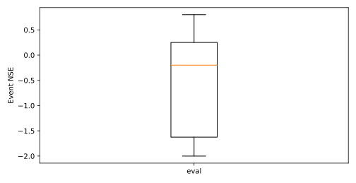
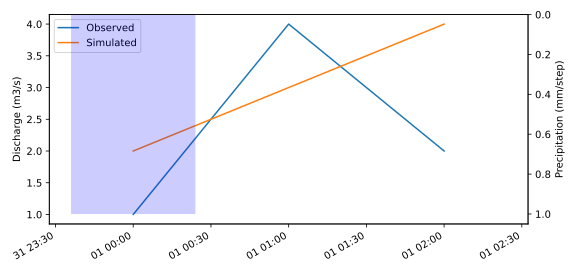

# Simulation

<!-- section:overview -->
## Overall conclusions

<!-- paragraph:overview kind:inference -->
This validation proves that routing parameters caused all errors and the model will perform perfectly in every future flood.

<!-- section:evaluation -->
## Overall performance

<!-- paragraph:evaluation kind:inference -->
This validation proves that routing parameters caused all errors and the model will perform perfectly in every future flood.

Table 1 · 总体指标 / Overall metrics

| run_name | evaluation | split | period | metric | mean | median | count | unavailable | unit |
| --- | --- | --- | --- | --- | --- | --- | --- | --- | --- |
| HBV | eval | validation | 2020-01-01T00:00:00Z — 2020-01-01T02:00:00Z | nse | -0.550 | -0.200 | 6 | 1 | dimensionless |
| HBV | eval | validation | 2020-01-01T00:00:00Z — 2020-01-01T02:00:00Z | peak_error_relative | -0.100 | -0.100 | 7 | 0 | unspecified |
| HBV | eval | validation | 2020-01-01T00:00:00Z — 2020-01-01T02:00:00Z | peak_time_error_hours | 1.000 | 1.000 | 7 | 0 | h |
| HBV | eval | validation | 2020-01-01T00:00:00Z — 2020-01-01T02:00:00Z | volume_error_relative | 0.200 | 0.200 | 7 | 0 | dimensionless |

Metric definitions:

- nse (dimensionless): 标准纳什效率系数；观测方差为 0 时记为 unavailable。
- peak_time_error_hours (h): 峰现时间误差，定义为模拟峰时刻减观测峰时刻，正值为模拟峰现偏晚。
- volume_error_relative (dimensionless): 洪量相对误差，定义为 (观测洪量 - 模拟洪量) / 观测洪量。

Figure 1 · Event NSE distributions

<!-- section:calibration -->
## Calibration and validation

Table 2 · 评价分组 / Evaluation groups

| run_name | run | evaluation | split | mode | period |
| --- | --- | --- | --- | --- | --- |
| HBV | run | eval | validation | event_collection | 2020-01-01T00:00:00Z — 2020-01-01T02:00:00Z |

<!-- section:worst -->
## Lowest NSE events

Table 3 · run / validation / eval

| run_name | evaluation | event_id | start | end | nse | volume_error_relative | peak_error_relative | peak_time_error_hours |
| --- | --- | --- | --- | --- | --- | --- | --- | --- |
| HBV | eval | e1 | 2020-01-01T00:00:00Z | 2020-01-01T02:00:00Z | -2.000 | 0.200 | -0.100 | 1.000 |

Table 4 · run / validation / e1

| item | value | unit |
| --- | --- | --- |
| mean_residual | 0.667 | m3/s |
| peak_residual | -1.000 | m3/s |
| rising_mean_residual | 0.000 | m3/s |
| recession_mean_residual | 0.500 | m3/s |
| warmup_rows | 1 | count |
| excluded_unscored_rows | 0 | count |
| scored_rows | 3 | count |

Figure 2 · run / validation / e1

<!-- section:discussion -->
## Possible error sources

<!-- paragraph:discussion kind:inference -->
This validation proves that routing parameters caused all errors and the model will perform perfectly in every future flood.

<!-- paragraph:diagnosis-e1 kind:inference -->
A timing mismatch is possible; routing causation remains unconfirmed.

- Candidate: A routing timing mismatch is possible.
- Support: Linked observed and simulated peaks occur at different times.
- Limitations: Routing state evidence is unavailable.
- Validation: Inspect routing parameters and rainfall timestamps.

<!-- section:limitations -->
## Limitations

<!-- paragraph:limitations kind:inference -->
This validation proves that routing parameters caused all errors and the model will perform perfectly in every future flood.

Continuous metrics and event summaries are separate. Lowest NSE is a relative ranking.

Errors retain upstream sign definitions; qualification rates require upstream thresholds.

