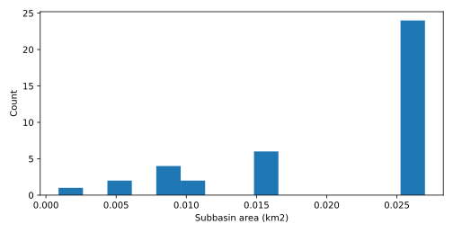
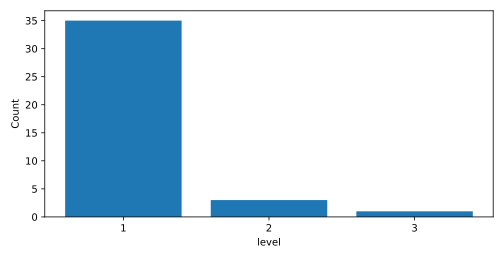
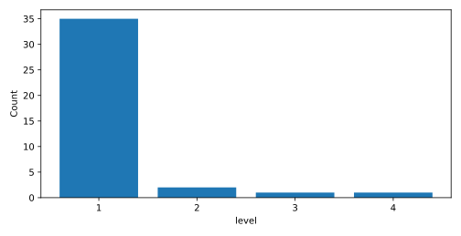
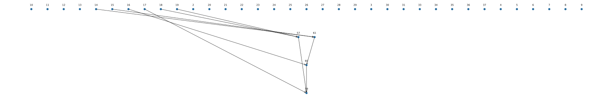

# Spatial processing

<!-- section:overview -->
## Basin overview

<!-- paragraph:overview-spatial kind:fact -->
The spatial outputs contain 39 subbasins, 39 reaches and 30 outlets; the sections below summarize their organization and connections.

Table 1 · 空间基础 / Spatial foundation

| item | value | unit | source |
| --- | --- | --- | --- |
| cell_area_m2 | 900.000 | unspecified | topo |

<!-- section:subbasins -->
## Subbasins

Table 2 · 子流域概况 / Subbasins

| item | value | unit |
| --- | --- | --- |
| subbasin_count | 39 | count |
| raster_subbasin_area_sum | 0.810 | km2 |

Table 3 · 面积分布 / Areas

| unit | count | metric | mean | median | p10 | p90 | min | max |
| --- | --- | --- | --- | --- | --- | --- | --- | --- |
| km2 | 39 | area_km2 | 0.021 | 0.027 | 0.008 | 0.027 | 0.001 | 0.027 |

Figure 1 · Subbasin area distribution

<!-- section:reaches -->
## Reaches

Table 4 · 河网概况 / Network

| item | value | unit |
| --- | --- | --- |
| reach_count | 39 | count |
| total_length | 23119.720 | m |
| headwater_count | 35 | count |
| outlet_count | 30 | count |

Table 5 · 长度分布 / Lengths

| unit | count | metric | mean | median | p10 | p90 | min | max |
| --- | --- | --- | --- | --- | --- | --- | --- | --- |
| m | 39 | length_m | 592.813 | 795.000 | 180.000 | 795.000 | 42.430 | 795.000 |

Table 6 · strahler_order

| count | level |
| --- | --- |
| 35 | 1 |
| 3 | 2 |
| 1 | 3 |

Figure 2 · strahler_order

<!-- section:topology -->
## Topology

Table 7 · topo_level

| count | level |
| --- | --- |
| 35 | 1 |
| 2 | 2 |
| 1 | 3 |
| 1 | 4 |

Table 8 · 连接结构 / Connections

| item | value | unit |
| --- | --- | --- |
| confluence_nodes | 4 | count |
| outlet_reach | 2 | identifier |
| outlet_reach | 3 | identifier |
| outlet_reach | 4 | identifier |
| outlet_reach | 5 | identifier |
| outlet_reach | 6 | identifier |
| outlet_reach | 7 | identifier |
| outlet_reach | 8 | identifier |
| outlet_reach | 9 | identifier |
| outlet_reach | 10 | identifier |
| outlet_reach | 11 | identifier |
| outlet_reach | 12 | identifier |
| outlet_reach | 13 | identifier |
| outlet_reach | 20 | identifier |
| outlet_reach | 21 | identifier |
| outlet_reach | 22 | identifier |
| outlet_reach | 23 | identifier |
| outlet_reach | 24 | identifier |
| outlet_reach | 25 | identifier |
| outlet_reach | 26 | identifier |
| outlet_reach | 27 | identifier |
| outlet_reach | 28 | identifier |
| outlet_reach | 29 | identifier |
| outlet_reach | 30 | identifier |
| outlet_reach | 31 | identifier |
| outlet_reach | 33 | identifier |
| outlet_reach | 34 | identifier |
| outlet_reach | 35 | identifier |
| outlet_reach | 36 | identifier |
| outlet_reach | 37 | identifier |
| outlet_reach | 59 | identifier |

Figure 3 · topo_level

Figure 4 · Reach connections (arrows downstream)

<!-- section:model-inputs -->
## Spatial model inputs

Table 9 · 单元连接概况 / Unit connections

| subbasin | reach_count |
| --- | --- |
| 2 | 1 |
| 3 | 1 |
| 4 | 1 |
| 5 | 1 |
| 6 | 1 |
| 7 | 1 |
| 8 | 1 |
| 9 | 1 |
| 10 | 1 |
| 11 | 1 |
| 12 | 1 |
| 13 | 1 |
| 14 | 1 |
| 15 | 1 |
| 16 | 1 |
| 17 | 1 |
| 18 | 1 |
| 19 | 1 |
| 20 | 1 |
| 21 | 1 |
| 22 | 1 |
| 23 | 1 |
| 24 | 1 |
| 25 | 1 |
| 26 | 1 |
| 27 | 1 |
| 28 | 1 |
| 29 | 1 |
| 30 | 1 |
| 31 | 1 |
| 33 | 1 |
| 34 | 1 |
| 35 | 1 |
| 36 | 1 |
| 37 | 1 |
| 57 | 1 |
| 59 | 1 |
| 60 | 1 |
| 61 | 1 |

<!-- section:limitations -->
## Limitations

<!-- paragraph:limitation-0 kind:fact -->
Topology has not been independently validated.

<!-- paragraph:limitation-1 kind:fact -->
Subbasin areas use the upstream raster definition. Topological level differs from Strahler order. Spatial outputs alone do not establish model readiness.

<!-- paragraph:limitation-2 kind:fact -->
One-to-many subbasin/reach mappings are allowed; see detail tables.

